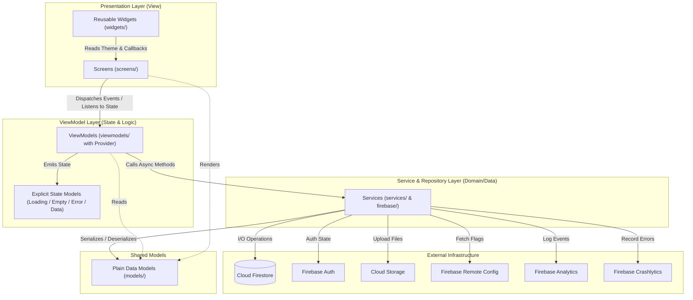
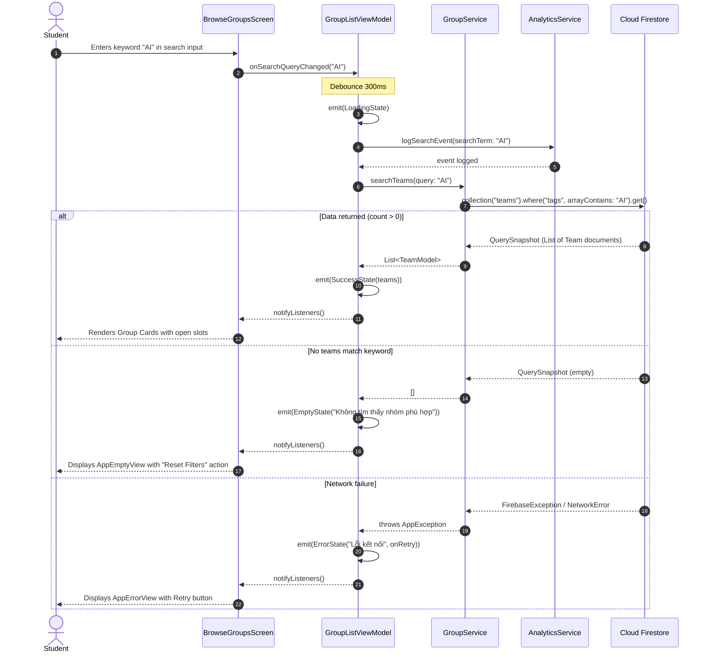

# Architecture Documentation — EXEMatching (PRM393 Lab 3)

## 1. Folder Structure Overview

```text
lib/
├── models/       # Immutable data models and state containers (shared across layers)
├── services/     # Business logic abstractions and Firebase SDK wrappers
├── firebase/     # Low-level Firebase initializations and options configuration
├── viewmodels/   # MVVM ChangeNotifier ViewModels managing UI states and user intents
├── screens/      # Pure presentation screens (observe ViewModels, forward user events)
├── widgets/      # Reusable design system components, state views (Loading/Empty/Error)
├── theme/        # Centralized design tokens (ColorScheme, TextTheme, AppSpacing, AppRadius)
└── utils/        # Helper utilities (PDF generation, date-time formatters)
```

---

## 2. Layer Diagram (Mermaid)

Dependencies strictly flow downwards. A layer never imports from or depends on the layer above it.



---

## 3. Sequence Diagram (Flow 1: Search & Browse Groups)



---

## 4. ViewModel to Services Dependency Table

Every ViewModel receives its required services via Dependency Injection (Provider). ViewModels never construct singleton instances of services directly, making them 100% unit-testable with mock/fake services.

| ViewModel Name | File Location | Services Injected & Used | Responsibilities |
|---|---|---|---|
| `AuthViewModel` | `lib/viewmodels/auth_viewmodel.dart` | `FirebaseAuthService`, `AnalyticsService` | Manages login state, Google SSO authentication, domain validation (`@fpt.edu.vn`), and sign-out. |
| `DashboardViewModel` | `lib/viewmodels/dashboard_viewmodel.dart` | `GroupService`, `RemoteConfigService` | Loads student's current capstone status, urgent deadline countdowns, and quick actions. |
| `GroupListViewModel` | `lib/viewmodels/group_list_viewmodel.dart` | `GroupService`, `AnalyticsService`, `RemoteConfigService` | Manages group search query, tag filtering, debouncing, and pagination. |
| `GroupDetailViewModel` | `lib/viewmodels/group_detail_viewmodel.dart` | `GroupService`, `AnalyticsService` | Displays roster, validates open slots ($< 5$), and handles join requests. |
| `MyGroupViewModel` | `lib/viewmodels/my_group_viewmodel.dart` | `GroupService`, `VotingService` | Loads user's active group details, member roles, and current election status. |
| `VotingViewModel` | `lib/viewmodels/voting_viewmodel.dart` | `VotingService`, `AnalyticsService` | Manages leader candidate selection, records votes, and listens to real-time vote tallies. |
| `LockReviewViewModel` | `lib/viewmodels/lock_review_viewmodel.dart` | `GroupService`, `StorageService`, `AnalyticsService` | Validates team quota ($\ge 4$ members), performs lock confirmation, triggers random pool recruitment on error path, and generates PDF. |
| `NotificationViewModel` | `lib/viewmodels/notification_viewmodel.dart` | `NotificationService` | Subscribes to FCM pushes, displays notification list, and routes on tap. |
| `ProfileViewModel` | `lib/viewmodels/profile_viewmodel.dart` | `FirebaseAuthService`, `StorageService`, `RemoteConfigService`, `CrashlyticsService` | Firebase demonstration hub: upload test file, trigger handled error/crash, reload Remote Config. |

---

## 5. Architectural Quality Checklist (Grading Rules Enforced)
- [x] **No SDK Direct Call:** No UI widget calls `http`, `FirebaseAuth.instance`, `FirebaseFirestore.instance`, or `FirebaseAnalytics.instance`.
- [x] **Zero Business Logic in UI:** All aggregation, filtering, quota validation, and string mutations reside in ViewModels or Services.
- [x] **Explicit ViewState:** Every screen loading asynchronous data observes a sealed `ViewState` (`InitialState`, `LoadingState`, `EmptyState`, `ErrorState`, `SuccessState`).
- [x] **Service Injection:** ViewModels receive interfaces via Provider, enabling isolated unit testing.
